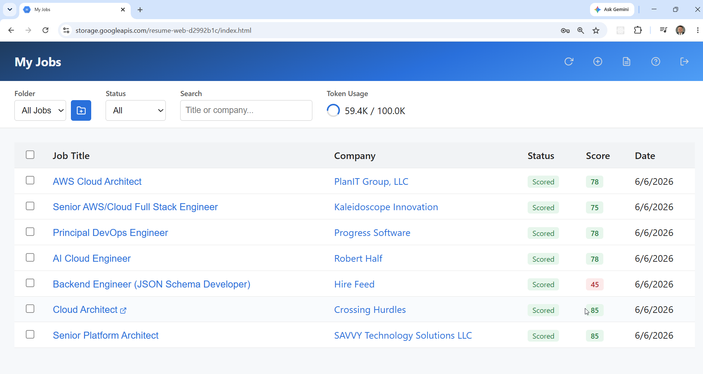

# Resume Scorer on GCP: Identity Platform, API Gateway, Pub/Sub and Gemini

A serverless **resume scoring** app. Users sign in with **Identity Platform**
(Firebase Auth), store one or more resumes, and submit job postings as a URL,
pasted text, or LinkedIn job IDs. An **API Gateway** checks the Firebase
token and forwards to a **Cloud Function** that queues each job on
**Pub/Sub**. An event-triggered worker function fetches the posting, has
**Gemini on Vertex AI** extract the job details and score the resume from 0
to 100, and writes an analysis split into strengths and weaknesses. Data
lives in **Firestore** and a private **Cloud Storage** bucket, and a vanilla
JavaScript single-page app on a public bucket ties it together.



| Piece | Where | Role |
|---|---|---|
| **Identity Platform** | project | email and password sign-in in the page; Google sign-in too when you supply an OAuth client; the browser uses an API key |
| **API Gateway** | `us-central1` | OpenAPI spec whose routes require a Firebase ID token for the project; calls the function as its own service account |
| **resume-api** | Cloud Functions | 2nd gen, Python 3.11, 256 MB, 60 s, up to 10 instances; every route; private, invokable only by the gateway |
| **resume-worker** | Cloud Functions | 2nd gen, Python 3.11, 512 MB, 540 s, up to 5 instances; Eventarc trigger on the topic with retries on |
| **resume-job-requests** | Pub/Sub | the job topic; also a pull subscription `resume-job-requests-sub` with a dead-letter topic after 5 attempts |
| **Firestore** | `(default)`, native | resumes, jobs, folders and users documents; composite indexes created by `api_setup.sh` |
| **resume-media-&lt;hex&gt;** | Cloud Storage, `US` | private; resume text, job descriptions, resume snapshots, analyses and attachments |
| **resume-web-&lt;hex&gt;** | Cloud Storage | public-read bucket with the SPA and its config |
| **Service accounts** | IAM | the API's (Firestore, publish, media object admin), the worker's (Firestore, subscribe, Vertex AI user, media object admin) and the gateway's |

## Architecture

<picture>
  <source media="(prefers-color-scheme: dark)" srcset="architecture-dark.svg">
  
</picture>

Regenerate with `python3 make_diagram.py`.

- **`01-backend/`**: the media bucket, the topic, subscription and
  dead-letter topic, the service accounts and roles, the browser API key,
  and the Identity Platform config (and the optional Google provider).
- **`02-functions/`**: both functions (code in `code/api/` and
  `code/worker/`), the gateway's service account, and the gateway built from
  `openapi.yaml.tpl`.
- **`03-webapp/`**: the web bucket and the SPA in `site/`.
- **`gemini-config.sh`**: the model ID, sourced by `apply.sh` and
  `check_env.sh`. **`probe_vertex.py`** lists which Gemini models your
  project can reach, with timings and token counts.

## How a job is scored

1. The page signs in with the Firebase Auth SDK and sends the ID token as a
   bearer token. The gateway checks it and passes the user's claims to the
   function, which uses them as the owner.
2. On first sign-in the page calls `POST /register`, which creates the user
   record, up to a cap of 100 users.
3. `POST /jobs` checks the user is under their token limit, saves a snapshot
   of the chosen resume, writes the job, and publishes it. LinkedIn job IDs
   become one job each.
4. The worker marks the job `Scoring`, fetches the URL (or uses the pasted
   text), strips it to visible text with BeautifulSoup, and calls Gemini
   once to extract the title, company and other fields and again to score
   the resume. It stores the analysis in the bucket, marks the job `Scored`,
   and adds the tokens to the user's `tokens_used` with an atomic
   `Increment`.
5. On failure it marks the job `Failed` with a message. It re-raises only
   errors a retry could fix (such as rate limits), so Pub/Sub redelivers
   those and drops the rest.

The default limit is **500,000** tokens per user for the account's lifetime;
`POST /jobs` returns `429` once it's used. To reset or raise it, edit
`tokens_used` or `token_limit` on the user's document in Firestore.

## API

Every route needs `Authorization: Bearer <Firebase ID token>`; everything is
scoped to the token's user.

| Area | Routes |
|---|---|
| Resumes | `POST /resumes`, `GET /resumes`, `GET`/`PUT`/`DELETE /resumes/{resume_id}` |
| Jobs | `POST /jobs` (URL, raw text or LinkedIn IDs), `GET /jobs`, `GET`/`DELETE /jobs/{job_id}`, `PATCH /jobs/{job_id}/notes`, `PATCH /jobs/{job_id}/folder` |
| Attachments | `GET`/`POST /jobs/{job_id}/attachments`, `GET`/`DELETE /jobs/{job_id}/attachments/{att_id}`; base64 JSON, up to 10 MB each |
| Folders | `POST /folders`, `GET /folders`, `DELETE /folders/{folder_id}` |
| Account | `POST /register`, `GET /usage` |

## Prerequisites

* [A Google Cloud Account](https://console.cloud.google.com/) with access to
  the Gemini model in `us-central1`
* [Install gcloud CLI](https://cloud.google.com/sdk/docs/install)
* [Install Terraform](https://developer.hashicorp.com/terraform/install)
* [Install Python 3.11+](https://www.python.org/downloads/) and
  [jq](https://jqlang.github.io/jq/download/)

Put a service account key in the repository root as `credentials.json`. If
this is your first time following along, we recommend starting with this
video: [GCP + Terraform: Easy Setup](https://youtu.be/3spJpYX4f7I).

## Deploy

```bash
git clone https://github.com/mamonaco1973/gcp-resume-app.git
cd gcp-resume-app
./apply.sh
```

`check_env.sh` signs in with `credentials.json`, runs `api_setup.sh`
(enables the APIs, creates the Firestore database and its indexes) and
checks the Gemini model. `apply.sh` then applies `01-backend`,
`02-functions` and `03-webapp`. It ends by running `validate.sh`, which
prints the URL:

```
===================================================================================
  Resume Scorer — Deployment validated!
===================================================================================
  App : https://storage.googleapis.com/resume-web-<hex>/index.html
===================================================================================
```

To use another model, change `GEMINI_MODEL_ID` in `gemini-config.sh`
(default `gemini-3.1-flash-lite`); run `./probe_vertex.py` first to see
which models answer.

### Optional: Google sign-in

1. In **APIs & Services > OAuth consent screen**, set the user type to
   **External**, fill in the app name and support email, and add yourself as
   a test user.
2. In **Credentials**, create an **OAuth 2.0 Client ID** of type **Web
   application**, with the JavaScript origin `https://storage.googleapis.com`
   and the redirect URI `https://<project-id>.firebaseapp.com/__/auth/handler`.
3. Export the client and run `apply.sh` again:

   ```bash
   export GOOGLE_OAUTH_CLIENT_ID="123456789-abc.apps.googleusercontent.com"
   export GOOGLE_OAUTH_CLIENT_SECRET="GOCSPX-..."
   ./apply.sh
   ```

Terraform then turns on Google as a provider, and the page's **Login with
Google** button works. Without the variables, Google sign-in isn't set up.
`validate.sh` prints the origin and redirect URI to use.

## Try it

1. Open the **App** URL and create an account with your email and a
   password (or use Google, if set up).
2. Open **Manage Resumes**, create a resume, and paste in its text.
3. Choose **Score New Job**, pick the resume and optionally a folder, and
   give the job as a URL, pasted description, or LinkedIn job IDs (one per
   line). The dashboard refreshes while jobs are pending.
4. Once a job shows **Scored**, open it to read the score, the strengths and
   weaknesses, and the extracted details. Add notes, move it to a folder, or
   attach files.

## Teardown

```bash
./destroy.sh
```

## Notes

- **Lab only.** Anyone can create an account, up to the 100-user cap.
- Documents get a `ttl` field 90 days out, but nothing sets a Firestore TTL
  policy on it, so they don't expire; the media bucket has no lifecycle
  rules either.
- `resume-job-requests-sub` and its dead-letter topic aren't used: the
  worker's Eventarc trigger has its own subscription, so the pull
  subscription just collects copies of every message until they expire.
